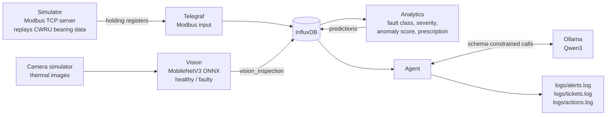

# Edge Predictive Maintenance

A containerised edge pipeline that watches an induction motor through an industrial protocol, diagnoses bearing faults from vibration, checks the result against a thermal camera, and lets a small local LLM decide what maintenance actions to take. It runs on a laptop-class machine with one command.

```
docker compose up --build
```

First start downloads about 3 GB of local LLM models (qwen3:4b and qwen3:0.6b) and takes 10 to 20 minutes. Until they arrive the agent keeps working on its rule-based policy, then switches to the LLM by itself. Needs Docker with about 8 GB of memory available.

## Architecture



| Service | Role |
|---|---|
| `simulator` | Modbus TCP device. Replays windowed vibration features from the CWRU dataset through a scenario (healthy, then inner, outer and ball faults of growing size). Ground truth goes to `shared/state.json`, never to the registers. |
| `telegraf` | Polls the Modbus registers every second and writes to InfluxDB. |
| `influxdb` | Time series store (`bearing_features`, `predictions`, `vision_inspection`, `agent_decisions`). |
| `analytics` | LightGBM fault classifier and fault-size classifier, Mahalanobis anomaly score on a healthy baseline, 10-window smoothing, and a rule table that turns a diagnosis into a maintenance action (the prescriptive step). |
| `vision` | Classifies a thermal frame as healthy or faulty (MobileNetV3-Small, ONNX Runtime, CPU). The camera is simulated and picks an image that matches the simulator's state. |
| `ollama` | Local LLM server (Qwen3 4B, with 0.6B as backup). |
| `agent` | Fuses analytics and vision, asks the LLM which functions to call (`send_alert`, `create_maintenance_ticket`, `no_action`), checks the answer against a policy, and executes it. |

### How the agent stays safe
- The LLM answers in a JSON schema, so the output is always a valid function call.
- A rule policy defines what must happen. The model chooses the functions and words the alert, but it cannot skip a required alert, change its severity or a ticket's priority, rewrite the ticket's action or time window, or raise an alarm the sensors do not support. A message that contains a number or fault type the sensors did not report is replaced by the rule-table text.
- If a sensor stops (or never starts), the agent raises a stale-data alert and repeats it every `REMINDER_S` seconds until data returns. A fault reading with low confidence is treated as a transition for `LOW_CONF_HOLD_S` seconds and acted on if it persists.
- Any alert text with a number, fault type or urgency that is not in the sensor report is replaced by a templated sentence.
- If the model is slow, down or invalid, the agent falls back to the 0.6B model and then to the rule policy. Stale sensor data raises its own warning.
- The agent only calls the model when the situation changes, plus a reminder every 2 minutes during a fault.

## What to look at while it runs
```
python scripts/check_pipeline.py     # latest data, predictions, vision, agent decisions, alert log
cat logs/alerts.log logs/tickets.log
docker compose logs -f agent         # e.g. "confirmed_fault -> send_alert,create_maintenance_ticket [llm, 5.0s]"
```
One scenario loop takes about 6.5 minutes. A step-by-step demo is in [docs/DEMO.md](docs/DEMO.md).

## Results
Numbers come from `analytics/models/metrics.json`, `vision/models/metrics.json` and the logs of a full run.

| Part | Test | Result |
|---|---|---|
| Fault classifier (CWRU, 4 classes) | train on one motor load, test on the other, smoothed | macro F1 0.962 (0 to 3 hp) and 0.999 (3 to 0 hp) |
| Fault size (7, 14, 21 mil) | same split | macro F1 0.973 and 0.868 |
| Healthy vs faulty | same split | recall 1.00 for both |
| Anomaly score | healthy baseline, time-ordered split | 16.7 % false alarms on held-out healthy data, 100 % of faults flagged |
| Thermal vision | leave one load out (no, medium, full load), 488 images | 488 of 488 correct with the camera text overlay blanked |
| Agent, Qwen3 4B | 9 probe calls on the real prompt | 9 of 9 valid, 1.6 to 4 s; live decisions 2 to 12 s on CPU |
| Whole stack | Docker memory use while running | about 4.6 GB of 7.75 GB |
| Clean start | fresh clone, no `.env`, no Docker cache (`docs/results/clean_clone_nocache.txt`) | all four InfluxDB measurements filled within 100 s of the models being ready |

The scenario run produces the expected sequence of decisions: no action when healthy, a warning with a medium ticket for a 7 mil inner fault, and critical alerts with high tickets for 14 and 21 mil faults and for outer and ball faults.

## Limitations (please read)
- **Replayed data.** The vibration data is a replay of CWRU recordings through a Modbus simulator, not a live machine. The demo scenario replays load-3 recordings that the deployed models also saw in training. The cross-load numbers above are the honest accuracy estimate.
- **Healthy baseline depends on load.** A healthy baseline from one load gave about 100 % anomaly false alarms at the other load, so the deployed baseline uses both loads. A new operating condition would need a new baseline.
- **Inner vs ball confusion.** Mid-size inner-race faults are the weakest case in the cross-load test.
- **Vision accuracy is probably optimistic.** The thermal dataset is easily separable (perfect score even with the camera overlay blanked), and healthy and corroded images may come from different sessions. It shows the pipeline works, not how well it would find subtle corrosion on another machine.
- **The vibration and thermal datasets come from different machines.** They are matched by condition only (healthy motor shows a healthy image), which is a simulation choice.
- **CPU-only LLM in Docker.** On macOS, Docker cannot use the GPU. Running Ollama natively (set `OLLAMA_URL=http://host.docker.internal:11434` and start with `--scale ollama=0`) is much faster.
- **The anomaly flag does not raise alerts.** The agent acts on the fault classifier and the camera. The anomaly score (16.7 % false alarms on held-out healthy data) is recorded in InfluxDB and used for the prescriptive text, but a reading that is merely anomalous, with a normal classification, is not escalated.
- **Sampling-rate assumption:** the CWRU normal baseline files are treated as 48 kHz and resampled to 12 kHz, following the dataset's documentation in the literature.

## Moving to a real machine
Only the Telegraf input changes: set `MODBUS_HOST` and `MODBUS_PORT` in `.env` and, if the device uses another register layout, edit the addresses in `telegraf/telegraf.conf`. Replace `vision/camera.py`'s `capture()` with a real camera grab. Analytics, agent and storage are unchanged.

## Retraining and data
```
python -m venv .venv && source .venv/bin/activate
pip install -r requirements-dev.txt        # numpy pandas scipy scikit-learn lightgbm torch torchvision onnx onnxruntime pillow influxdb-client python-dotenv
python scripts/prepare_cwru.py             # needs data/raw/cwru (CWRU Bearing Data Center)
python scripts/prepare_thermal.py          # needs data/raw/thermal (Mendeley thermal motor images)
python analytics/train.py
VISION_MASK_TOP=0.15 python vision/train.py
```
Run the unit tests with `pytest tests` (agent policy and guardrails, call validation, anomaly transform, prescriptive rules, simulated camera). They need no Docker and no datasets.

Raw datasets are not in the repository. Trained models, the processed feature table and a small demo image set are, so a clean clone runs without them.

## Datasets
- **Vibration:** Case Western Reserve University Bearing Data Center, seeded-fault bearing test data. https://engineering.case.edu/bearingdatacenter/download-data-file
- **Thermal images:** Kulkarni, V. V., Kundu, M., Simha, J. B. *Induction Motor-Thermal Images*, Mendeley Data, Version 2, 2026. DOI 10.17632/pymtdhfzbj.2, https://data.mendeley.com/datasets/pymtdhfzbj/2 (licence CC BY 4.0).

## Repository layout
```
analytics/   features, training, rules, live analyzer, models/
vision/      training, camera simulator, vision service, models/, demo_images/
agent/       app, LLM client, tools, policy, prompts/
simulator/   Modbus TCP replay server and scenario.yaml
telegraf/    telegraf.conf (the only file to change for a real device)
ollama/      entrypoint that pulls the models on first start
scripts/     data preparation, pipeline check, LLM probe, clean-clone test
tests/       unit tests (pytest tests)
docs/        DEMO.md (demo script) and results/ (evaluation and test outputs)
logs/        alerts.log, tickets.log, actions.log (written at runtime)
```

## Troubleshooting
- `docker compose ps` should show 7 services. `ollama` becomes healthy after the models are downloaded.
- Agent log says `mode=rules`: the LLM is still downloading or unavailable. Check `docker compose logs ollama`.
- Ports in use (8086, 5020, 11434): stop the other service or change the port mapping. All three are published on `127.0.0.1` only, so other machines on your network cannot reach the database, the Modbus server or Ollama.
- `python scripts/probe_llm.py qwen3:4b --mode json` measures how reliably a model makes valid calls.